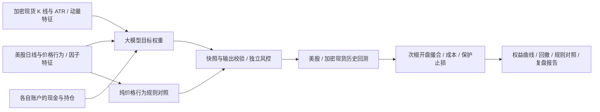

# QuantBot

**通过大模型生成目标持仓，由独立风控约束，在历史行情上回测并复盘。模拟盘接入暂缓，当前流程以回测报告结束。**

QuantBot 0.3.0 将 PABot、StockBot、QuantPilot 和 CoinBot 收敛为一个 Python 包、一个 `quantbot` 命令、一个网页工作台和一个 Rust 研究内核。价格行为、多因子、股票研究和加密策略在同一项目维护；模型配置与目标权重协议共用，股票账户和加密账户分别记账。

**价格行为是 AI 量化交易的一类输入和子策略。** 美股 AI 使用趋势、突破、回调、成交量、ATR 和因子评分，并可导入按历史可得时间裁剪的 SEC 公告；加密现货 AI 使用 OHLCV、ATR、动量和趋势信息。纯价格行为模式可独立作为美股规则对照，AI 决策不必满足原 PABot 的每一条入场条件。其他新闻、财报研究结果尚未接入主交易决策链路。

## 当前能力

日内研究新增[盈利证据与独立验证](docs/INTRADAY-PROFIT-VALIDATION.md)：复核机会与成本、检查分钟数据及历史可得性证据，从完整开发回放重算累计检验后冻结独立验证。工程通过、独立研究合格、来源认证和交易许可分别报告；原止盈止损、准出门槛与封存留出保持不变。

2026-10-28 完成第一轮执行流程收敛：修复对照正常熔断造成的误淘汰，以及旧加密回测漏扣入场费、首尾权益低估回撤和固定 15 分钟计时问题。主历史评估、本地持久账户与日内研究现在共用 Decimal 账本和成交量约束撮合核心，保留部分成交、余单、延迟、到期与保护退出；美股保持整数股，加密保持现货数量步长。`engineering_passed` 只表示工程完整，不能授予交易资格；券商模拟入口在创建客户端前核验冻结策略证据，当前适配尚未具备准出绑定，继续阻断。旧冻结结果不改写，新代码需要新研究版本。详见 [统一执行与策略准入](docs/EXECUTION-CONVERGENCE.md)。

| 入口 | 已实现行为 | 执行范围 |
|---|---|---|
| `backtest` / 网页历史回测 | 美股、加密现货共用评估与次根开盘撮合，输出规则对照、权益、成本及错误报告 | 当前默认流程；独立账户，不启用持续任务 |
| `intraday-study` / [双市场日内研究](docs/INTRADAY-RESEARCH.md) | 自动生成有限因子组合、完整登记与批量筛选、导出关闭的策略草案；复用 5 分钟撮合、15 分钟信号、部分成交、成本、延迟与独立对账 | 加密公开历史可用；美股真实分钟数据仍阻断；原日线冷却、止盈止损、准出和封存留出不变 |
| `python -m quantbot.ai.development` / 双市场离线策略开发 | 冻结加密与美股候选、三组开发窗口及连续账户、两档成本、独立对账和相关性 | 确定性规则，零模型调用；只形成进一步研究名单，不授予准出 |
| `python -m quantbot.factors.conditional_study` / 状态归因与因子筛选 | 真实入场周期对齐六类事前状态，检验四类因子的扣费净贡献与增量，保留失败和空池 | 双市场离线开发证据；通过后仍需另行冻结策略及账户回放 |
| `python -m quantbot.factors.paired_study` / 回踩与换仓配对研究 | 在真实决策前复制账户，比较 BTC 回踩确认与 ETF 换仓成本覆盖，保留原保护单并独立对账 | 局部事件增量，不等于组合收益；因子合格后才构建策略 |
| `python -m quantbot.factors.cross_asset_study` / 跨资产因子研究 | 先刷新修复后的原基准，再验证 ETH 同步趋势与 ETF 五日相对胜出 | 固定假设、配对对账、128 项校正；空池停止，不授予准出 |
| `python -m quantbot.factors.leadership_study` / 相对领先因子研究 | 验证 BTC 相对 ETH 领先、ETF ATR 归一化总收益优势 | 复用修复后的基准并核对源码；130 项校正；空池停止 |
| `python -m quantbot.ai.economic_study` / 盈利归因 | 复核旧回测账目，分解费用、资金占用、目标到订单的缩量、取消单和完整持仓周期；观察退出后 5/10 个交易时点 | 描述性分析；收盘与成交观测不能还原日内极值，不生成新策略 |
| `python -m quantbot.factors.mechanism_study` / 机制执行探针 | 四项预登记机制、同原点候选/对照、原风控和撮合、两档费用、独立账目核验与累计校正 | 离线开发研究；数据阻断保留失败，合格后才进入策略构建 |
| `python -m quantbot.factors.replan_study` / 除息重规划研究 | 实际撤单回报驱动的一次重规划、相同五资产对照、加密信号漏斗、冻结执行和对账 | 仅离线探针；原保护规则与准出政策不变 |
| `python -m quantbot.factors.screening_study` / 双市场入场筛选 | 加密每日超跌事件的趋势/反弹确认、ETF 短期趋势/成本缓冲，保留次根撮合和除息重规划 | 四项固定候选、两档费用、累计 139 项检验；独立原点贡献不是连续策略收益 |
| `python -m quantbot.ai.research_catalog` / 跨目录研究登记 | 导入已知试验和已读数据区间、保留失败，预登记有限假设，拒绝将重叠历史重新标为独立样本 | 版本不可覆盖，计入预热区间；不替代正式准出账本，旧入口尚未全部接入 |
| `runtime study-*` / 网页策略研究闭环 | 研究卡片、冻结候选与数据、开发窗口、一次留出、成本/仓位压力与随机对照、DSR/PBO、完整证据导出 | 区分运行完成、研究达标、未达标和证据不足；不启用模拟盘 |
| `vintage` / 历史行情版本 | 按发布时间选择修订、冻结首版撮合价格；整股拆并股、普通美元分红应收与支付、独立对账 | CLI/网页主回测与研究共用；来源与公司行动完整性尚未独立认证 |
| `runtime operations` / 研究运行看板 | 计划与实际时间、持久化队列、中断归档、数据状态与模型用量 | 并发上限 1；需显式启动队列，不启动交易模拟 |
| `options-backtest` / 持仓期权研究 | 已有持仓的持股/备兑/保护性看跌/领口对比，含提前指派压力、分红、换月和现金对账 | 历史报价回放；独立研究工具，未接入 LLM 选期权与通用留出检验 |
| `sec-archive` / `sec-study` / SEC 历史事件研究 | 跨季度索引归档、原文和修订版本、可得时点约束、固定窗口与基准超额、成本压力 | 独立事件描述统计；默认使用首次取得时间，不把受理时间等同于公开时间 |
| `decide` / 网页美股计划 | 完整日线 → AI 或价格行为规则 → 风控后的整数股计划 | 离线预览；CLI 保存 JSON 与账本，不提交订单 |
| `simulate` | 信号日收盘决策，下一交易日开盘撮合，计入成本和保护性止损 | 美股历史回放 |
| `paper` | 保留券商账户、订单恢复与保护单实现；先检查冻结策略身份及准出证据 | 当前准出绑定未完成，创建客户端前阻断；单独确认不能放行 |
| `crypto ai` | 离线现货 K 线 → AI 目标权重 → Decimal 数量计划 | 计划或本地 paper，不连接交易所账户与订单 |
| `runtime` / 网页回测研究 | 自动行情、持久化任务、恢复、订单管理、账户熔断、版本评估与绩效 | 回测、滚动评估与版本管理；持续模拟保留为后续步骤 |
| 网页加密策略 / `crypto strategy` | 13 种规则策略、扫描、回测和验证 | 网页只使用固定行情与本地 paper；CLI Demo 保留原验证门禁 |
| 网页研究 / `research` / `price-action` | 股票、期权、宏观、加密研究及原有实验工具 | 研究结果与交易计划分开 |
| `core` | Rust 指标、回测、参数优化、Walk-Forward、ONNX 推理 | 研究内核，不代替交易账本 |

统一入口的实盘交易关闭。旧直接下单接口、旧券商适配器写入和旧 `agent execute-live` 入口已停用；研究文字中的 BUY/HOLD/SELL 不会直接生成订单。

2026-10-23 新增双市场四项入场筛选：加密每日超跌趋势过滤、三日内反弹确认，ETF 短期趋势和成本缓冲。先冻结 97 个加密事件原点、86 个 ETF 月末原点及代码，完成 1,464 次账户回放、22,984 个时点独立对账。四项均未筛出合格因子，累计 139 项试验保留；79 项相关测试通过。XLF 异常行情、512 条分红公告时间和价格修订历史仍有缺口。原止盈止损、准出政策和封存留出不变，没有新策略或模拟盘。详见[本轮因子筛选](docs/FACTOR-SCREENING.md)、[上一轮除息重规划](docs/DIVIDEND-REPLAN.md)及[研究登记](docs/ECONOMIC-RESEARCH.md)。

加密现货现按“回测准出 → OKX 模拟盘前向验收 → 小额实盘准备”推进。`runtime crypto-policy` 查看冻结阈值，`runtime study-admission <研究ID>` 核验回测、有效成交、压力测试与独立账目证据。首版要求至少 180 日研究、60 日独立留出；OKX 模拟盘另需至少 60 日证据。当前处于回测阶段，检查不会启动账户，模拟盘执行与晋级连接尚待接入。详见 [加密分级准出](docs/CRYPTO-ADMISSION.md)。



## 快速开始

需要 Python 3.12 或更新版本。以下命令在项目根目录执行；网页开发另需 Node.js，Rust 内核的源码构建另需 Rust 工具链。

```sh
python3 -m venv .venv
.venv/bin/python -m pip install -e '.[workbench,dev,data,automation]'
.venv/bin/quantbot --version

# 美股与加密现货各跑一次完整回测，使用合成行情和规则，不调用模型。
.venv/bin/quantbot backtest --market stocks --provider demo
.venv/bin/quantbot backtest --market crypto --provider demo
```

每次在新的 `runs/backtest-*` 目录保存 `report.json`、输入 CSV、不可变行情快照与独立评估记录。默认回测最近 30 根预热后的 K 线，产生 29 次策略决策；最后一根只估值。演示验证流程，不证明策略收益。旧美股 `demo`、`simulate` 命令继续保留。

启动网页工作台：

```sh
.venv/bin/quantbot serve
# 打开 http://127.0.0.1:8001
```

首页「运行中心 → AI 量化交易」默认选择历史回测。选择美股或加密现货，导入 CSV 或含发布时间的行情 JSON、填写回测根数并运行，即可查看和下载报告；不需要启动 worker 或连接模拟盘。选择「离线演示」才使用规则，未导入行情时明确使用合成行情。AI 模式需要先配置模型，并单独允许该次回测的模型调用。网页与 CLI 使用同一主配置。

本机安装目录和 Python 发行包已包含构建好的网页。修改前端后，在 `frontend` 目录执行 `npm ci`、`npm run build`，构建完成会同步 Python 包内网页资源，随后可在项目根目录执行 `python -m build` 构建安装包；也可用 `quantbot serve --frontend <已构建目录>` 指定网页资源。监听端口可用 `--port` 修改。

## 回测与复盘（当前默认流程）

股票和加密现货的统一命令：

```sh
# 用真实历史 CSV 跑规则对照；默认从 CSV 推导标的。
.venv/bin/quantbot backtest --market stocks --provider price_action --data data/daily.csv --last-bars 30
.venv/bin/quantbot backtest --market crypto --provider demo --data data/crypto.csv --last-bars 30

# 加密研究候选：趋势/突破/回撤或持仓型动量，不调用模型。
.venv/bin/quantbot backtest --market crypto --provider crypto_rules \
  --config config/crypto-rules.example.toml --data data/crypto.csv --last-bars 30

# 含行情版本与公司行动的原始价格输入，与 --data 二选一。
.venv/bin/quantbot backtest --market stocks --provider demo --vintage-data data/stocks-vintages.json --last-bars 30

# AI 回测：先配置模型，再明确允许本次历史区间的调用。
.venv/bin/quantbot backtest --market crypto --provider ai --data data/crypto.csv --last-bars 30 --allow-model-calls
```

`--provider demo` 配合 CSV 或历史版本 JSON 时使用提供的数据和动量规则，不合成行情；未导入行情才使用演示数据。`--initial-cash` 可指定初始资金，`--output` 必须是尚不存在的新目录。CLI 输出完整报告 JSON；检查通过返回 0，数据/模型/风控检查失败返回 2。回测期间的模型错误记录在报告中，不以成功结果掩盖。

`crypto_rules` 用于 CLI 和 runtime 的加密现货候选筛选，要求提供行情。`strategy.crypto_rule` 可选 `momentum_hold`、`trend_fast`、`breakout`、`pullback`；持仓期间不因低于初始目标比例而每天补仓，退出信号、保护止损和仓位上限仍生效。原 `demo` 动量规则保持不变，继续作为同窗口对照。具体信号、成本假设和研究边界见 [加密规则研究](docs/CRYPTO-RULES-RESEARCH.md)。

新增 `trend_filtered` 震荡过滤与 `strength_rotation` BTC/ETH 强弱轮动；[轮动配置](config/crypto-rotation.example.toml) 显式启用 3 根冷却、3%/ATR 较紧止损和 6% 止盈。止盈止损由执行器处理并随账户持久化；同根触及两条线且无法判断先后时按止损优先。策略只通过历史筛选不能获得交易准出，门槛见 [加密分级准出](docs/CRYPTO-ADMISSION.md)。

网页使用 `POST /api/quantbot/allocate`，指定 `mode="simulate"`、`market`、`provider`、`csv_data` 和 `last_bars`；AI 还需 `allow_model_calls=true`。统一回测响应中的 `candidate` 是策略结果，`baseline` 是规则结果，另有 `checks`、`snapshot`、`passed` 和 `report_path`。原计划和 paper 模式保留原行为。

带发布时间的输入使用 `vintage_data` 对象替代 `csv_data`。美股主回测支持已声明的整股拆并股和普通美元现金分红：原始价格用于撮合，拆股后的历史特征只使用当时已生效的信息；分红先计入应收权益、支付日收盘再转为现金。网页展示分红权益、待到账金额和逐次行动；完整报告保留全部输入。碎股、特殊分配、退市及合并条款仍会明确拒绝。输入格式与可重跑样例见 [公司行动回测](docs/AI-CORPORATE-ACTIONS.md)。

默认股票特征需要 127 根、加密需要至少 35 根预热历史。回测 30 根分别至少需要 156 根股票日线或 64 根加密 K 线；自定义更长指标窗口时需要更多。两类市场都在下一根开盘撮合并计入估计成本，股票数量为整数，加密数量为 Decimal。末尾持仓按市值计价，不强制虚构最后一根清仓。收益、回撤、成交、成本、逐次决策和错误均保留；同区间比较规则与现金基线。

零成交量 K 线不生成普通订单或保护止损的成交，记录 `no_market_volume`，保留未卖出的持仓和止损。一般流动性限制、部分成交及真实价差模型仍待接入，固定成本估计不能代表真实成交能力。

当前验收为：完整行情校验 → 决策 → 独立风控 → 回测撮合 → 绩效报告。需要比较版本时，在「回测研究与版本对比」创建候选，或使用下面的命令：

```sh
.venv/bin/quantbot runtime create --name daily-baseline --provider price_action --source csv --data data/daily.csv
.venv/bin/quantbot runtime evaluate <任务ID> --last-bars 30
.venv/bin/quantbot runtime walk-forward <候选ID> <另一候选ID> --selection-bars 30 --test-bars 10 --folds 3 --gap-bars 1
.venv/bin/quantbot runtime show <任务ID>
```

到查看报告即可结束。候选回测不改动持续模拟账户，不自动启用任务。已有本地持续模拟能力保留在页面的后续步骤中；`serve --worker`、`runtime resume` 不属于当前回测操作流程。

行情来源包括持续读取 CSV、美股 Yahoo 未复权日线，以及 OKX 无密钥公开 K 线。公开行情接入只读取价格，不接入 OKX 交易账户。美股按交易日历检查节假日、提前收盘和缺失交易日；加密按 UTC 周期检查连续性与收盘状态。行情过期、修订或恢复区间不足会暂停任务。每次处理前保存不可变行情快照。

默认日内亏损上限 3%、账户回撤上限 10%，连续三次模型失败暂停新决策；恢复需处理告警并明确确认，恢复不会重置回撤高水位。暂停会取消待执行订单，运行服务继续检查已有本地持仓的保护止损。模拟清仓在下一根可用 K 线执行，不会在缺失或过期行情上生成成交。

AI 历史评估和持续运行分别需要 `--allow-model-calls`，网页也有明确的模型调用选项。候选版本冻结模型、参数与源码指纹，评估比较候选、规则和现金基线；版本切换使用独立模拟账户，保留旧版本供恢复。检查通过表示该历史区间的流程有效，不代表盈利或真实渠道验收。

滚动评估支持 1..6 个固定候选共用行情与成本，先记录参考窗口的版本选择，再评估互不重叠的后续窗口。逐折报告保留决策、成交、收益、回撤、调用用量和准入原因；窗口独立初始化资金，以平均收益汇总，不虚构连续复利。启用时重新核对通过记录、配置与源码指纹及行情证据。参数与限制见 [滚动评估说明](docs/AI-EVALUATION.md)。

详细命令、行为边界、恢复方法和验证记录见 [回测与可选持续模拟说明](docs/AI-RUNTIME.md)。富途模拟盘、老虎实盘和 OKX 模拟/实盘的统一 AI 交易接入按当前要求暂缓。

本次回测入口的实际验证见 [回测验证记录](docs/AI-BACKTEST-VALIDATION.md)。

回测、滚动评估和研究试验会在调用前落盘输入，并逐步保存决策、账户与成交。异常失败可下载完整失败报告，进程中断可只读检查已保存证据；新评估启动即撤回旧准入，不自动重试未确认的模型调用。命令与边界见 [回测异常留痕与中断检查](docs/AI-REPLAY-RECOVERY.md)，实际验收见 [故障恢复验证记录](docs/AI-REPLAY-RECOVERY-VALIDATION.md)。

`runtime replay-show <日志路径> --reconcile` 可从逐笔成交独立重算现金、持仓、损益与权益，定位记录差异；见 [回测账目核验](docs/AI-RECONCILIATION.md)。

## 策略研究闭环

新增双市场离线开发入口：`python -m quantbot.ai.development --plan <冻结计划.json> --market crypto|stocks`。首批登记 6 个加密候选、3 个美股候选，每市场另有现金和原动量两组对照；每批从登记表冻结最多 6 个研究候选，支持只验证新增子集。首版后分别预登记加密 RSI<50 回撤与美股 ETF 目标连续两日有效确认两个改进，禁止扫阈值。每个策略在三个开发窗口和连续账户中分别运行基础/双倍成本。美股沿用整数股执行，显式启用 3% 止损、6% 止盈和退出后 3 个交易日冷却。报告保留独立账目、风控停机、期末潜在卖出成本及策略相关性；开发名单不替代原准出门槛，也不启动模拟盘或实盘。用法、冻结计划与行情/分红的事后重建边界见 [双市场策略开发](docs/DUAL-MARKET-DEVELOPMENT.md)。

上一轮 11 个研究候选（加密 7、美股 ETF 4）连同对照完成 120 次运行，加密 72 次、美股 48 次；旧股票 6 次完整与 1 次中断另存。仅 BTC 过滤突破保留开发研究，正式准出仍为 0，策略模型调用为 0。收益与淘汰原因见 [双市场完整结果](docs/DUAL-MARKET-DEVELOPMENT.md#本轮完整结果)。

上一轮先冻结方案和研究源码，再对 BTC 突破与 ETF 轮动按市场状态归因，筛选成交量确认、收盘位置、波动收缩、趋势持续性四类因子。16 次既有回放的 18,488 个账户快照重新对账通过；两市场共 8 项因子均未通过稳定性与净增量检验，因此没有构建新策略或新增账户回测。BTC 四种过滤均减少原路径净利润；ETF 趋势持续性虽有正增量点估计，置信区间仍跨零。91 项相关测试通过。原准出门槛、止盈止损与封存留出不变，详见 [状态归因与条件因子研究](docs/CONDITIONAL-FACTOR-RESEARCH.md)。

上一轮验证 BTC 突破后的回踩确认、ETF 主动换仓的成本覆盖，两项假设均未通过。每档成本 BTC 有 77 次原机会、44 次确认成交，但三个窗口的增量全为负；ETF 有 47 次主动换仓机会，30 bps 下虽减轻亏损，候选净贡献仍为负，且仅 12 次保留后实际成交，未达到 30 次要求。成对事件入口复用真实账户、原保护单和分红，248 组配对比较（含两档成本）的 496 条分支、7,100 个新增账户快照独立对账通过。54 项相关测试通过；未构建新策略、未进入模拟盘，原风控、准出门槛和封存留出不变。详情见 [回踩与换仓配对研究](docs/PAIRED-FACTOR-RESEARCH.md)。

上一轮先修复公司行动下的换仓计划：任一挂单因除息/拆并股失效时，同一目标计划全部撤回，分红与旧保护单继续有效。真实 2024-06-21 事件在两档成本下修复验证通过；重新运行原策略 16 条基准路径，加密八条账户与订单均与旧版一致。随后按冻结方案检验“BTC 的 ETH 同步趋势确认”和“ETF 五日相对胜出多数”：BTC 每成本 77 次机会、66 次保留成交，虽有正净贡献但总体增量为负；ETF 每成本 50 次机会、35 次保留、23 次成交，净贡献仍为负且成交样本不足。两项均未通过，共 254 组配对比较、508 条分支、7,160 个新增账户快照对账通过；99 项相关测试通过。未构建新策略，止盈止损、准出门槛、原封存留出不变，模拟盘和实盘继续关闭。详见 [执行修复后的跨资产因子研究](docs/CROSS-ASSET-FACTOR-RESEARCH.md)。

最新一轮先归因 BTC 被 ETH 条件过滤的盈利机会、ETF 换仓亏损，再冻结相对领先与风险调整动量两项因子。BTC 每成本 77 次机会、40 次保留成交，虽有正净贡献，但两个成本三个窗口的增量全为负；ETF 每成本 50 次机会、38 次保留、23 次保留后成交，15 bps 下净贡献和增量为正，但 30 bps 下仍亏损、成交样本和跨窗稳定性不足，未通过完整筛选。复用已修复原基准并核对全部既有源码；254 组配对比较、508 条分支独立对账，36 项相关测试通过。两项均未入选，未构建新策略，风控、准出门槛和原封存留出不变，未进入模拟盘。详情见 [相对领先因子研究](docs/LEADERSHIP-FACTOR-RESEARCH.md)。

加密因子研究新增 `quantbot factor-study register/run`：冻结 12 个版本化因子和 1/5/10 日标签，分别检验 BTC/ETH 时间序列预测力、费用覆盖、开发窗口稳定性与多重比较，保留全部失败并允许空池。该入口不调用策略模型或交易，不代表策略盈利；公式、命令和统计边界见 [加密因子研究](docs/CRYPTO-FACTOR-RESEARCH.md)。因子组合与目标持仓映射仍待后续验证。

可用 `--validation-days 730` 扩大每个验证窗口，并用 `--prior-study <旧研究目录>` 导入既有因子研究。同目录研究及已导入的祖先会自动去重，既有失败也计入本轮统计校正；窗口在登记时冻结，原成本、有效样本要求及交易准出门槛不降低。

网页「回测研究与版本对比」中可直接登记假设、冻结候选与数据，执行开发窗口验证和一次最终留出测试，再查看成本/仓位压力、固定种子随机对照及 DSR/PBO 诊断。每个窗口的决策、成交、成本、权益和失败记录均保留，下载报告包含实际冻结行情。

```sh
.venv/bin/quantbot runtime study-create --plan research-plan.json
.venv/bin/quantbot runtime study-run <研究ID>
.venv/bin/quantbot runtime study-show <研究ID>
.venv/bin/quantbot runtime studies
```

研究卡片格式、模型预算和全部标准见 [AI 策略研究闭环](docs/AI-RESEARCH.md)。包含 AI 候选时，执行命令必须显式加 `--allow-model-calls`；登记不会调用模型。方案冻结后不能修改或重复运行，同一运行目录中已经使用的最终留出区间会标记为证据不足。

基础回测的 `passed` 仍表示运行完整性。新研究单独输出 `execution_completed` 和 `conclusion`（研究达标 / 未达标 / 证据不足）；运行完成不等于研究达标，研究达标也不自动批准模拟盘或实盘。CSV/公开行情的完整历史可得性和公司行动仍未验证。

本轮实际检查与合成行情样例见 [研究闭环验收记录](docs/AI-RESEARCH-VALIDATION.md)。

历史版本数据契约、研究排队和看板使用方式见 [历史版本行情与研究运行](docs/AI-DATA-OPS.md)。整体推进范围与尚未完成项见 [开发状态](docs/DEVELOPMENT-STATUS.md)。

本轮全局回归、网页实际操作、故障恢复与账目核验记录见 [研究工程验证记录](docs/AI-ENGINEERING-VALIDATION.md)。

持仓期权的输入契约、六组对比、可复现样例及范围见 [持仓期权研究](docs/AI-OPTIONS-OVERLAY.md)。完整报告冻结输入和策略参数，合成样例不证明投资收益。

SEC 跨季度归档、历史版本和事件窗口研究见 [SEC 历史事件研究](docs/AI-SEC-EVENTS.md)。公告也可通过 `backtest --sec-context`、研究候选或网页导入接入主 AI 回测：逐决策裁剪当时可得的正文版本，保留截断和覆盖缺口，随行情冻结并完整导出。用法与证据边界见 [SEC 公告输入](docs/AI-SEC-CONTEXT.md)。独立事件窗口统计仍不等于受资金约束的组合回测。

## 接入大模型与本地 Codex

统一决策支持 `openai_compatible` 和 `codex_cli` 两种来源，股票与加密现货共用。本地 Agent 可以负责研究、调用命令和复盘；每个交易决策可以再由本机 Codex CLI 的独立会话完成。行情、风控、撮合和记账仍由 QuantBot 执行。

使用已登录的本机 Codex，不需要另填 QuantBot API Key：

```sh
cp config/quantbot.codex.example.toml config/quantbot.codex.toml
# 在新配置的 llm.model 中填写本机 Codex 可用的模型名称。
.venv/bin/quantbot model-check --config config/quantbot.codex.toml

# 首轮 3 根回测 K 线，对应 2 个模型决策时点；需提供足够的预热行情。
.venv/bin/quantbot backtest --config config/quantbot.codex.toml \
  --market crypto --provider ai --data data/crypto.csv \
  --last-bars 3 --allow-model-calls
```

`model-check` 只检查本机安装、登录和配置，不请求模型，不证明模型权限或可用额度。每次 Codex 调用使用独立临时目录、只读沙箱、结构化输出，并关闭外部检索、命令执行、插件和记忆；检测到工具事件会拒绝结果。模型与推理强度由 QuantBot 显式配置，忽略 Codex 用户配置中的其他工具和行为设置，Codex 自行使用现有登录。本机 CLI 是调用入口，模型通常仍在远端运行，也不会继承当前聊天历史。

完整 Agent 操作步骤、公开行情入口、研究预算和复盘方法见 [本地 Codex 驱动](docs/AI-CODEX-AGENT.md)。

2026-10-21 已使用真实 Codex 模型与 OKX 公开行情完成 BTC/ETH 的有限回测：2 个决策时点、2 笔回测成交，AI 候选和规则基准均通过独立对账。相关回归 54 项通过。详细记录与失败留痕见 [真实 Codex 回测验收](docs/AI-CODEX-VALIDATION.md)；该次结果证明流程可运行，尚未证明策略有效。

使用 OpenAI 兼容接口时，密钥通过环境变量注入：

```sh
cp config/quantbot.example.toml config/quantbot.toml
export QUANTBOT_LLM_BASE_URL='https://api.openai.com/v1'
export QUANTBOT_LLM_MODEL='填写账户可用的模型名称'
export QUANTBOT_LLM_API_KEY='填写密钥'

.venv/bin/quantbot serve --config config/quantbot.toml
```

`openai_compatible` 使用 `/chat/completions` 接口。远程地址必须使用 HTTPS；本机兼容服务可使用 `http://127.0.0.1:端口/v1`，填写其实际模型名。主 AI 配置不自动读取 `.env`，未配置模型时明确报错，不隐式切换到演示。修改配置或环境变量后重新启动网页服务。

配置优先级是内置默认值 → TOML → `QUANTBOT_LLM_BACKEND` / `QUANTBOT_LLM_BASE_URL` / `QUANTBOT_LLM_MODEL` 环境变量。兼容接口的 `llm.api_key_env` 指定读取密钥的环境变量，默认是 `QUANTBOT_LLM_API_KEY`；Codex 来源不使用该密钥或 `base_url`。

- `fallback_models = ["备用模型名"]`：兼容接口最多四个备用模型，共用同一接口和密钥环境变量；服务调用失败时按顺序尝试，实际选用模型写入计划和账本。Codex 来源必须为空，不自动重复启动或切换模型。
- `response_format = "json_object"`：默认要求 JSON。兼容服务支持时可改为 `json_schema`；不支持该参数时显式设为 `none`。所有模式都执行本地严格校验。
- 无效字段、重复或越界标的、错误快照和时间、拒答或截断都会拒绝本次决策；不能通过切换模型绕过输出校验。

股票、加密现货与研究文字共用模型设置。研究文字不会直接转成订单，交易模型只能提出目标权重、置信度和理由。

本地 Agent 可以调用 `backtest`、读取报告、调整候选后再做滚动评估。Codex CLI 已接入决策与研究问答，研究问答在 CLI 完成后返回整段内容。Claude CLI 尚未接入。规则演示与受控 CLI 测试不等于已验证真实模型效果。

## 风险约束

风控由程序执行，模型不能修改。默认值见 [主配置示例](config/quantbot.example.toml)：

| 配置 | 默认值 |
|---|---|
| 单标的权重上限 `max_weight` | 20% |
| 总暴露上限 `max_gross_exposure` | 60% |
| 最大持仓数 `max_positions` | 5 |
| 现金缓冲 `cash_buffer` | 10% |
| 单笔新增止损风险 `risk_per_trade` | 账户权益的 0.5% |
| 组合止损风险预算 `max_portfolio_heat` | 账户权益的 3% |
| 置信度下限 `min_confidence` | 0.70 |

股票按整数股规划，加密币量使用 Decimal。两条路径共享风控参数与决策语义，分别计算数量、成本、止损和账户状态。

现有 Alpaca Paper 的账户准入使用券商返回的账户事实（broker-reported account risk），包括交易限制、保证金状态和可用购买力，不从本地资产金额推导券商限制。新增本地模拟任务的亏损、回撤熔断是独立的策略运行约束。

## 美股行情、计划与回放

CSV 必须包含且仅包含以下字段，一行对应一个标的一根完整日线：

```csv
date,symbol,open,high,low,close,volume
2026-10-02,SPY,600,603,598,602,1000000
```

默认股票池为 SPY、AAPL、MSFT，基准必须包含在股票池内。每个标的在信号日都需要完整日线及预热历史；默认至少 127 根，增大特征窗口会增加要求。

```sh
# 下载研究行情；end 不包含当天。
.venv/bin/quantbot download --start 2024-01-01 --end 2026-10-05 --output data/daily.csv

# 生成 AI 计划，保存 JSON 与同名 SQLite 复盘账本。
.venv/bin/quantbot decide --data data/daily.csv --as-of 2026-10-02 --output runs/decision-20261002.json

# AI 历史回放会调用配置的模型，可能产生服务费用。
.venv/bin/quantbot simulate --data data/daily.csv --start 2025-07-01 --end 2025-07-25

# 纯价格行为对照，使用相同风控与执行路径，不调用模型。
.venv/bin/quantbot simulate --data data/daily.csv --strategy price_action --start 2025-07-01 --end 2025-07-25
```

`decide` 默认使用配置中的初始资金作离线预览；也可通过 `--account portfolio.json` 提供账户 JSON：`{"cash":100000,"equity":100000,"positions":{}}`。已有输出文件不会覆盖；再次运行使用新路径。`simulate --output` 应指定空的输出目录。

回放在信号日收盘决策、下一交易日开盘撮合。买入跳空超过限价时取消，成本、DAY 委托过期和保护性 ATR 止损进入账本。统一入口的 `price_action` 与原 PABot 完整回测的参数及成交假设有差异；复现旧实验使用下方的研究入口。

下载工具使用 yfinance 自动调整的 OHLC，属于研究数据。自选股票池可能有幸存者偏差，历史模型推理也可能受训练记忆影响；历史回放收益不能代替前瞻模拟交易证据。

## Alpaca 模拟盘

```sh
export ALPACA_API_KEY='模拟账户密钥'
export ALPACA_SECRET_KEY='模拟账户密钥'
.venv/bin/quantbot paper --data data/daily.csv --confirm-paper
```

每次运行执行一个周期，固定连接 Alpaca Paper。使用空的专用模拟账户；当前支持美股整数股多头。行情必须覆盖券商日历确认的上一交易日，命令在常规交易时段评估。账户资金、持仓和交易限制以券商返回的事实为准；网页初始资金字段不能代替券商账户资金。

网页与 CLI 在相同主配置和运行目录下，对同一 Alpaca Paper 账户使用同一账户账本，同账户同执行日只决策一次。订单身份在网络提交前持久化；提交结果不确定时先按 `client_order_id` 查询。卖出前确认自有止损取消，卖出未完成时暂停新增订单，残余持仓恢复保护性止损。

买入限价单附带券商原生 OTO 保护性止损，条件单使用 GTC。工作订单、未知提交结果、外部订单、未受保护持仓或账户变化可能触发 `recovery_hold`；核对账户与账本后处理，不能通过删除账本解除门禁。异常周期不会自动补交剩余计划。

主链路使用静态 ATR 止损；原 PABot 的吊灯跟踪止损保留在研究模块。券商 Paper 与本地回放的委托有效期、滑点和成交行为分别验证，保护性止损不保证成交价。

## 加密现货 AI 与本地 paper

```sh
# 显式离线演示，并将模拟成交写入独立账本。
.venv/bin/quantbot crypto ai --demo --mode paper --initial-cash 1000 --ledger runtime/crypto-demo.sqlite

# 真实模型 + 离线行情：默认只生成计划。
.venv/bin/quantbot crypto ai --config config/quantbot.toml --data data/crypto.csv --symbols BTC/USDT ETH/USDT

# 使用真实模型生成计划，并记录本地模拟成交。
.venv/bin/quantbot crypto ai --config config/quantbot.toml --data data/crypto.csv --symbols BTC/USDT ETH/USDT --mode paper --initial-cash 1000 --ledger runtime/crypto-ai-paper.sqlite
```

CSV 格式如下，`timestamp` 是带时区的 K 线开盘时间，示例使用 UTC：

```csv
timestamp,symbol,open,high,low,close,volume,bar
2026-05-10T00:00:00+00:00,BTC/USDT,50000,50200,49900,50100,1000,15m
```

- 支持 `15m`、`1h`、`1d`。每个标的至少需要 `max(35, atr_window + 1)` 根完整、连续、同周期 K 线，所有标的的末根收盘时间对齐；未收盘或未来 K 线会拒绝。
- 当前 AI 现货使用 mock USDT 交易对元数据，支持 BTC、ETH、SOL、XRP、DOGE、ADA；代码格式如 `BTC/USDT`。币量使用 Decimal，模拟最小数量同时作为数量步长。
- 本地 paper 在快照收盘价加成本成交，现金、持仓、止损和去重记录写入独立 SQLite。已有止损按后续 K 线处理，新买入不使用此前 K 线低价触发止损。
- 同一快照重复请求返回已有结果，不再次调用模型或成交。每次本地 paper 运行先检查已有止损，再请求模型分配；模型请求或输出校验失败时停止新增分配。改变初始资金、模型、风险参数、标的或行情来源后使用新账本。

`crypto ai --mode paper` 这一旧入口不读取交易所账户、不发交易所订单。其收盘价撮合不同于当前 `backtest --market crypto` 的次根开盘撮合，也不等同于 OKX Demo。

## 加密规则策略与研究内核

```sh
.venv/bin/quantbot crypto strategy catalog --json
.venv/bin/quantbot crypto --help
```

保留的 13 种策略包括跨所与三角套利、资金费率与基差对冲、趋势突破、均值回归、波动收缩突破、动量轮动、订单簿失衡、区间网格、DCA 组合和对冲做市。它们有独立的规则与验证流程，策略目录存在不代表已获真实交易准入。

网页加密策略仅运行固定行情和本地 paper，单次最多三轮。CLI 的 OKX Demo 路径需显式配置并通过策略自己的门禁；所有策略的 `live_supported` 均为 `false`。报价中的机会收益标记为 `estimated_opportunity`，不能作为实际成交收益。

Rust 内核在另一个终端启动：

```sh
# 从源码首次使用，或修改 Rust 代码后构建。
cargo build --release
.venv/bin/quantbot core
```

默认监听 `127.0.0.1:8002`，网页通过统一服务转发研究请求。`core` 需要项目中的 `target/release/quantbot-quant-server`；本机安装目录已有构建产物，其他平台需要重新构建。ONNX 模型默认位于 `shared/fixtures/models`，可用 `QUANTBOT_MODEL_DIR` 指定模型目录。研究结果与股票、加密交易账本分别保存。

工作台保留有后端实现的研究功能；公开源码中没有对应后端的模型训练和全流程 AutoPilot 网页操作已移除。

## 合并后的代码与旧研究入口

| 来源 | 统一位置 | 用途 |
|---|---|---|
| PABot | `src/quantbot/price_action` | 价格行为特征、规则、回测、复盘与治理 |
| StockBot | `src/quantbot/trading`、`src/quantbot/data` 等 | 交易领域、执行账本、PIT、多因子与统计验证 |
| QuantPilot | `src/quantbot/stocks` | 股票、期权、宏观研究与账户读取 |
| CoinBot | `src/quantbot/crypto`、`src/quantbot/crypto/runtime` | 加密研究、13 种策略及验证工具 |
| 共享设施 | `src/quantbot/common`、`src/quantbot/models` | 数据与类型、加密工具、模型路由 |
| 统一 AI 链路 | `src/quantbot/ai`、`src/quantbot/web` | 结构化决策、风控、回放、模拟盘与 API |
| 网页与研究内核 | `frontend`、`quant-core` | 单一工作台、单一 Rust crate |

```sh
.venv/bin/quantbot research --help
.venv/bin/quantbot research strategy-readiness --help

# 原价格行为报告需要绘图等可选依赖。
.venv/bin/python -m pip install -e '.[price-action]'
.venv/bin/quantbot price-action backtest --config config/price-action.legacy.yaml
```

旧研究工具使用各自明确标记的配置与数据契约。原 Normal/DayTrade 验证门禁、封存窗口和已否决实验结论继续有效；纯价格行为治理约束不覆盖新 AI 策略。历史 snapshot 路径和源码哈希不会自动迁移，复现实验需要重新冻结数据与源码身份。

合并未迁入密钥、券商账户、行情缓存、历史交易账本或旧 Git 元数据。来源指纹见 [PABot/StockBot 血缘](docs/source-lineage.json) 与 [本轮融合血缘](docs/unification-lineage.json)，旧文档保存在 [docs/history](docs/history)。

## 开发验证与验收边界

```sh
.venv/bin/python -m pytest tests -q
.venv/bin/python -m ruff check src/quantbot/ai src/quantbot/cli.py src/quantbot/crypto/ai.py src/quantbot/crypto/ai_cli.py src/quantbot/web/app.py tests/test_quantbot_ai.py tests/test_unified_platform.py
```

在 `frontend` 目录运行 `npm test`、`npm run build`；在项目根目录运行 `cargo test --workspace`。历史代码的风格告警尚未统一清理，静态检查应覆盖实际修改范围。

2026-10-07 的 0.3.0 合并验收记录：Python **3197 passed、471 subtests passed**，网页 **32 passed**，Rust **62 passed**；网页构建、Rust release 构建和安装依赖检查通过。验收环境使用 Python 3.14.6，详细证据见 [合并验收](docs/UNIFICATION-VALIDATION.md)，功能归属见 [收敛说明](docs/UNIFICATION.md)。原 0.2.0 证据见 [历史合并验收](docs/MERGE-VALIDATION.md)。

该验收覆盖离线演示、本地模型协议模拟、历史回放与本地 paper；未调用真实大模型、Alpaca Paper 或 OKX Demo，未验证实盘或长期收益。第三方研究数据服务及可选深度学习依赖也未逐一完成真实联调。
