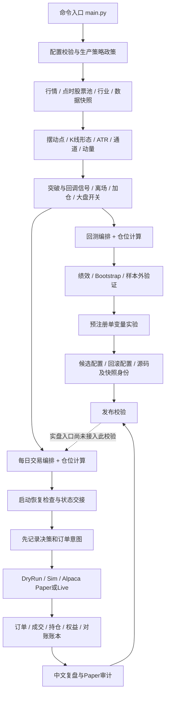

# PABot 功能架构与后续开发建议

核查日期：2026-09-11（本轮开发前）。依据当时工作区源码、已有文档、全量测试、隔离场景复现和 Alpaca 官方文档。

后续实现状态：下文缺口 1–4 已完成修复，模式/账户报告选择和固定时钟测试也已接入；
当前共 20 个命令，258 项测试通过。旧快照重建、60 日真实 Paper、止损成交模型与
实盘发布授权仍未完成。本文保留开发前证据与排序；最新功能清单和更新记录统一维护在
[项目进展](/Users/bytedance/code/PABot/docs/2026-07-27-summary.md)。

## 直接执行

**项目定位与当前判断**

PABot 是一个美股日线趋势交易系统，以价格行为产生交易方向，覆盖历史研究、本地模拟、券商模拟、实盘执行、交易复盘和候选版本校验。技术形态是 **Python 模块化单体 + 命令行定时运行 + 本地文件/SQLite 持久化**。

当前核心策略和研究工具已经较完整；执行、取证和发布之间仍有明确缺口，不能将它描述为已经完成验收的自动实盘系统。尤其需要区分：策略代码共用、订单决策一致、成交模型一致、发布授权强制执行，是四件不同的事。

开发前共有 19 个命令入口、49 个 Python 业务源码文件（12,911 行，含注释和空行）、27 个测试文件。规模仅用于定位工程形态，不代表质量评分。

**功能架构**

图中为职责关系。实际交易时，恢复检查发生在行情刷新和任何交易之前；订单意图先入账，再调用券商。

| 层 | 已实现功能 | 代码依据 | 当前边界 |
| --- | --- | --- | --- |
| 命令与配置 | 下载、快照、回测、样本外验证、四种执行模式、对账、报告、实验、候选包、Paper 审计；未知字段和数值范围校验 | [main.py](/Users/bytedance/code/PABot/main.py:545)、[config.py](/Users/bytedance/code/PABot/pabot/config.py:202) | 没有 Web 服务或可视化操作台；没有发布应用、回滚、人工解除 HOLD 的完整命令流程 |
| 数据 | yfinance 日线和 Parquet 缓存、S&P 500 历史成分、代码别名、63 日成交额筛选、行业缓存、原子发布快照和 SHA-256 校验 | [downloader.py](/Users/bytedance/code/PABot/pabot/data/downloader.py:226)、[snapshot.py](/Users/bytedance/code/PABot/pabot/data/snapshot.py:264) | 退市行情覆盖仍不完整；行业数据是当前分类；行情加载会改写传入配置；部分下游读取仍会写快照 |
| 特征 | 分形摆动点及确认滞后、HH/HL 结构、吞没/锤子/内包线、ATR、突破/离场通道、动量与流动性 | [features.py](/Users/bytedance/code/PABot/pabot/priceaction/features.py:33) | 已有截断一致性测试；这证明特征计算的时间约束，不等于证明外部历史数据没有修订或缺失 |
| 策略与仓位 | 突破、回调反转、结构止损、吊灯跟踪、通道离场、金字塔加仓、大盘开关、风险预算、行业和同公司约束 | [trend_breakout.py](/Users/bytedance/code/PABot/pabot/strategy/trend_breakout.py:73)、[manager.py](/Users/bytedance/code/PABot/pabot/risk/manager.py:22) | 策略函数共享；候选池、执行顺序和组合约束仍分别在回测与 runner 编排 |
| 回测与研究 | 事件驱动组合回测、滑点/佣金/现金利息、退市持仓清算、快慢路径等价、收益归因、Bootstrap、配对检验、7 折样本外框架 | [engine.py](/Users/bytedance/code/PABot/pabot/backtest/engine.py:375)、[stats.py](/Users/bytedance/code/PABot/pabot/backtest/stats.py:114)、[walkforward.py](/Users/bytedance/code/PABot/pabot/backtest/walkforward.py:102) | 默认样本外网格为 54 组，窗口固定到 2025 年；已有历史结果当前不能从旧快照重新验证 |
| 交易执行 | 交易时段检查、进程锁、数据刷新、未完结 K 线剔除、先离场后加仓/入场、真实成交回填、稳定订单 ID、未知状态冻结 | [runner.py](/Users/bytedance/code/PABot/pabot/live/runner.py:445)、[alpaca_broker.py](/Users/bytedance/code/PABot/pabot/broker/alpaca_broker.py:220) | 当前主要使用市价单；没有与回测对应的盘中托管止损；模式之间默认共享本地状态路径 |
| 事实与复盘 | SQLite 七类业务事实及状态 checkpoint，只追加、事务、幂等、订单状态交接、中文日报、三态对账 | [journal.py](/Users/bytedance/code/PABot/pabot/review/journal.py:1)、[evidence.py](/Users/bytedance/code/PABot/pabot/live/evidence.py:118)、[reconcile.py](/Users/bytedance/code/PABot/pabot/live/reconcile.py:293) | `review` 使用账本，但 `report` 仍读共用 CSV；Paper 的收盘时间语义尚不成立 |
| 实验与版本治理 | 单变量假设、同数据基线/候选比较、不可覆盖实验产物、候选和回滚配置、源码指纹、Paper campaign、发布校验函数 | [experiment/runner.py](/Users/bytedance/code/PABot/pabot/experiment/runner.py:430)、[bundle.py](/Users/bytedance/code/PABot/pabot/governance/bundle.py:452)、[release.py](/Users/bytedance/code/PABot/pabot/governance/release.py:82) | 前瞻验证产物尚未接齐；没有 Git 版本基线；发布校验尚未接入 `live` 入口 |

**默认策略具体做什么**

1. 从信号日的 S&P 500 成分股中，筛选滚动成交额前 100 名。
2. SPY 126 日动量为正时允许开新多仓；个股要求上升结构和正动量。
3. 收盘突破此前 55 日高点，或回撤至少 1.5 ATR 后出现吞没/锤子反转，产生入场候选；按动量/波动率排序。
4. 用入场价到止损价的距离计算仓位；默认单笔预算 2.5%、单仓市值上限 20%、最多 10 仓、每行业最多 3 仓，并做同公司股类去重。
5. 用结构/ATR 初始止损、4.5 ATR 吊灯跟踪和 45 日通道破位管理离场；盈利后按配置分两次加仓。

依据：[默认配置](/Users/bytedance/code/PABot/config.yaml:14)、[入场评估](/Users/bytedance/code/PABot/pabot/strategy/trend_breakout.py:73)、[离场与加仓](/Users/bytedance/code/PABot/pabot/strategy/trend_breakout.py:225)。这里的风险比例是计划仓位预算，并非真实成交损失上限。

做空、SPY 底仓、波动率杠杆以及其他历史研究开关仍保留代码，但不是当前默认生产策略。生产政策明确禁止财报过滤、时间止损以及 `shorts/base_position/leverage` 三类模块。历史“已证伪”结论的收益数字尚未在可信新快照上复核。

**四种执行模式与三类持久化**

| 模式 | 执行行为 | 用途 |
| --- | --- | --- |
| `dry-run` | 券商适配器只打印买卖意图，返回空持仓和模拟账户；runner 仍可能写本地状态 | 流程演习，当前需要与其他模式隔离 |
| `sim` | 本地撮合和记账，无需券商密钥 | 功能联调；不能替代券商 Paper 证据 |
| `paper` | 调用 Alpaca 模拟账户 | 券商接口和运行流程验证；正式日审计需 campaign 绑定 |
| `live` | 调用真实账户，要求配置匹配及显式确认参数 | 当前存在入口，但发布授权尚未强制接入 |

依据：[模式选择](/Users/bytedance/code/PABot/main.py:96)、[DryRunBroker](/Users/bytedance/code/PABot/pabot/broker/base.py:170)、[SimBroker](/Users/bytedance/code/PABot/pabot/broker/sim_broker.py:39)。

- **券商事实**：订单和实际持仓以券商读取结果为准。
- **策略状态**：`live_state.json` 保存止损、初始风险、加仓次数等券商没有的字段；文件哈希与账本 checkpoint 关联。
- **审计事实**：SQLite 保存决策到成交的追加事件。CSV 仍承担旧绩效报表的数据输入，形成了与账本并存的第二条报告链。

**当前核查结果**

| 检查 | 本轮实际结果 | 能得出的结论 |
| --- | --- | --- |
| 全量测试 | 221 通过、1 失败、1 条第三方弃用警告；隔离目录重跑结果相同 | 不能沿用文档中的“222 个全绿” |
| 失败位置 | `test_registered_paper_run_emits_auditable_campaign_identity`，信号日等于执行日，触发日期契约 | 测试夹具依赖真实当天日期；本次失败发生在构造 campaign 阶段 |
| 配置政策检查 | 通过 | 仅说明配置符合当前策略政策，不是发布或实盘验收通过 |
| Git | 无 HEAD、无远端；现有业务文件尚未纳入首个提交 | 缺少可审计的提交基线 |
| 快照 20260726 | 清单声明 876 个文件；缺版本字段；清单内逐文件比对发现 `sectors.json` 不符 | 当前消费入口会拒绝 |
| 快照 20260727 | 清单声明 857 个文件；缺版本字段；清单内逐文件比对发现 `sectors.json` 不符 | 默认配置指向的快照不可用 |
| 本地运行证据 | 当前 `logs` 下仅发现两份 CSV，未发现 `trading_journal.sqlite`；未发现默认交易状态文件 | 这份工作区不能提供正式 Paper 日数证明；不推断其他机器或目录的情况 |
| 历史收益/WF/压力 | 本轮未重跑 | README 年化、回撤等只作为历史记录，不能写成本轮验证结果 |

测试的日期问题可定位到 [夹具默认日期](/Users/bytedance/code/PABot/tests/conftest.py:25)、[失败用例](/Users/bytedance/code/PABot/tests/test_runner_journal.py:159)、[campaign 日期约束](/Users/bytedance/code/PABot/pabot/review/paper.py:227)。

本轮补充复现均使用临时目录、合成行情和模拟券商，未连接真实账户或提交外部订单。现有测试会向项目 CSV 追加合成记录；本轮首次测试产生的 16 条权益、4 条成交记录，经隔离重放逐字节匹配后已移除，原有记录保留。未修改策略、配置、交易流程或测试源码。

**需要优先处理的具体缺口**

**1. 演习与真实运行共用状态，存在跨模式改写。已隔离复现。**

`cmd_trade` 切换券商适配器，但继续传同一配置；runner 按 `live.state_file` 和 `review.journal_path` 使用同一状态和账本。`DryRunBroker.get_positions()` 返回空集合，runner 随后清理“不在券商侧”的本地持仓并持久化。

隔离复现：先建立带有效 checkpoint 的模拟盘 `TST` 持仓状态，再用同配置跑无候选的 `dry-run`，持仓由 `TST` 变为空。没有券商订单，也足以改变策略状态。

依据：[入口复用配置](/Users/bytedance/code/PABot/main.py:132)、[状态路径](/Users/bytedance/code/PABot/pabot/live/runner.py:129)、[空券商持仓](/Users/bytedance/code/PABot/pabot/broker/base.py:183)、[状态清理](/Users/bytedance/code/PABot/pabot/live/runner.py:604)。

**2. 快照重建后，回测的行业加载仍试图写只读文件。已隔离复现。**

`BacktestEngine` 在行业约束开启时调用 `load_sector_map`，该函数即使缓存完整也无条件重写 `sectors.json`。新快照文件被设为只读，二者冲突。

隔离复现：新建含两只合成标的和完整行业缓存的快照，全量哈希通过；以默认同类行业约束初始化引擎，因写 `sectors.json` 抛出 `PermissionError`。失败后快照哈希仍通过。因此后续任务不能仅列为“重新下载并冻结数据”，还需要打通快照下游只读消费。

依据：[回测加载行业](/Users/bytedance/code/PABot/pabot/backtest/engine.py:205)、[行业缓存无条件写入](/Users/bytedance/code/PABot/pabot/data/sectors.py:59)。

**3. 行情刷新改变配置哈希，使正式 Paper 证据自相矛盾。已隔离复现。**

campaign 冻结启动前配置哈希；`load_market_data` 将同一配置中的 `data.cache_dir` 改成 live 缓存目录；记录器随后对被改写的配置计算哈希。当前配置中研究目录和 live 目录不同，正好会触发这条路径。

隔离复现：使用实际数据加载函数，仅替换其网络/磁盘数据取得部分；无订单运行完成后，日审计返回 `CONFIG_HASH_MISMATCH`。直接注入行情、跳过加载函数时没有这一失败，说明现有注入式测试遗漏了真实入口的副作用。

依据：[加载函数改写配置](/Users/bytedance/code/PABot/pabot/data/downloader.py:255)、[runner 刷新行情](/Users/bytedance/code/PABot/pabot/live/runner.py:508)、[账本计算配置哈希](/Users/bytedance/code/PABot/pabot/live/evidence.py:160)、[Paper 哈希检查](/Users/bytedance/code/PABot/pabot/review/paper.py:733)。

**4. “收盘证据”实际在每日交易结束时生成，没有校验收盘时间。已隔离复现。**

推荐任务时点是 09:35；runner 完成后立即记录权益和三类对账，记录器固定写 `phase=close`。审计主要检查标签、身份和数值，没有确认该记录发生在交易所当日收盘之后。普通交易入口在盘外又会直接跳过，当前没有独立的收盘采集流程。

隔离复现：将合成账本的记录时间固定为 2026-09-11 09:35 美东，一天的记录仍通过日审计。复现设置最小日数为 1，仅验证单日判定，不代表通过正式 60 日门槛。修复配置哈希问题也不能替代修复这一时间语义问题。

依据：[时段检查](/Users/bytedance/code/PABot/pabot/live/runner.py:484)、[运行后记录](/Users/bytedance/code/PABot/pabot/live/runner.py:1513)、[固定 close 标签](/Users/bytedance/code/PABot/pabot/live/evidence.py:427)、[审计 close 记录](/Users/bytedance/code/PABot/pabot/review/paper.py:821)、[定时样例](/Users/bytedance/code/PABot/scripts/crontab.example:11)。

**5. 回测盘中止损与每日执行的次日卖出，是不同的成交模型。代码和现有测试明确支持这一判断。**

回测在当天低点触及止损时按止损价撮合，跳空时按当天开盘价撮合；runner 用昨日最低价判断是否触发，随后在本次运行时提交市价单。现有 parity 测试甚至明确将“引擎当天止损”和“runner 次日卖出”配成同一决策。

因此测试证明了部分标的选择和止损参数一致，不能证明成交日、成交价、路径资金或实际风险一致。开盘价撮合与 09:35 之后实际执行也存在时间差。影响需要重新回放测量，不能直接断言收益会下降多少。

依据：[回测盘中撮合](/Users/bytedance/code/PABot/pabot/backtest/engine.py:583)、[runner 昨日止损判断](/Users/bytedance/code/PABot/pabot/live/runner.py:699)、[parity 测试定义](/Users/bytedance/code/PABot/tests/test_parity.py:8)、[市价单适配](/Users/bytedance/code/PABot/pabot/broker/alpaca_broker.py:241)。

**6. 发布校验“不能放行”，但实盘入口也“未使用它”。这是两个独立缺口。**

候选包创建和重验都固定返回 `forward_evidence_verified=False`，发布校验因此不能接受 WF、压力、完整测试、Shadow 四类前瞻证据。这是保守的未完成接口，并非可以把布尔值手工改为真解决的问题。

另一方面，`live` 当前主要检查生产配置、`broker.paper=false` 和显式确认参数，然后构造券商并进入 runner；它没有消费通过发布校验的授权产物。恢复门禁仍然存在，但恢复安全与版本获准发布不是同一条件。

依据：[前瞻证据固定未验证](/Users/bytedance/code/PABot/pabot/governance/bundle.py:710)、[四类发布检查](/Users/bytedance/code/PABot/pabot/governance/release.py:224)、[实盘入口](/Users/bytedance/code/PABot/main.py:123)。

**7. 绩效报表和影子对账还不是可直接解释的策略偏差分析。**

旧 `report` 读取固定 CSV 并按日期保留最后一行，缺少账户、模式和 campaign 分组；runner 写 CSV 的日期是信号日，权益则来自执行时刻。`reconcile` 默认从配置中的历史起点重新回测，真实账户可能从更晚日期、不同初始持仓开始，严格股数不一致不能直接解释成执行故障。`sim` 的定时样例调用 `reconcile` 时，CLI 默认仍尝试读取 Alpaca，而不是本地 SimBroker。

依据：[CSV 写入](/Users/bytedance/code/PABot/pabot/live/runner.py:1454)、[报告按日期覆盖](/Users/bytedance/code/PABot/pabot/live/report.py:34)、[影子起点](/Users/bytedance/code/PABot/pabot/live/reconcile.py:293)、[默认 Alpaca 读取](/Users/bytedance/code/PABot/pabot/live/reconcile.py:78)。

**8. 恢复能力目前止于冻结，缺少可审计的处置闭环。**

启动检查能识别未决订单、外部工作订单、读取失败、成交未完成本地交接、状态回滚等，并进入 HOLD。即使券商随后已经终态，未完成本地交接仍会继续 HOLD；当前没有独立人工核对、生成处置方案、确认交接并恢复的命令。

依据：[恢复检查](/Users/bytedance/code/PABot/pabot/live/recovery.py:78)、[终态但未交接仍冻结](/Users/bytedance/code/PABot/pabot/live/recovery.py:214)、[现有命令集合](/Users/bytedance/code/PABot/main.py:545)。

## 深度交互

**开发优先级的前提**

以下排序以“先让历史研究可复现、模拟交易可验证，再考虑实盘和新策略”为目标。当前代码最缺的是跨模块的真实运行闭环。继续堆叠指标或优化样本内收益，无法解决上面已复现的问题。

**可以继续实现的功能与优化**

| 优先级 | 开发项 | 最小有用交付 | 验收条件与依据 |
| --- | --- | --- | --- |
| P0 | 运行模式与账户隔离 | 明确每种模式/账户的状态、锁、账本和报告归属；演习使用独立输出 | 带有效持仓和 checkpoint 的 Paper 状态，在 `dry-run/sim` 前后字节不变；对应缺口 1、7 |
| P0 | 可信研究数据链 | 修复行业等附属数据的只读消费；配置身份不受路径解析改变；在此基础上重建快照、重跑基线 | 开启默认行业和点时池约束后，回测/实验全程不写快照，前后全量哈希一致；真实加载路径的 campaign 配置哈希一致；对应缺口 2、3 |
| P0 | 正式 Paper 每日闭环 | 分离开盘执行与收盘只读采集；统一交易日、信号日、实际采样时刻；每天审计原因可追踪 | 09:35 记录不能算收盘；半日市和节假日正确；真实加载入口成功累计合格日；对应缺口 3、4 |
| P0 | 执行与回测止损对齐 | 先明确采用每日检查还是盘中保护，按同一规则回放；若保留盘中硬止损，补券商托管保护单和成交处理 | 比较成交日期、数量、价格假设和现金路径；覆盖入场当天止损、跳空、部分成交、改单竞态和重启；对应缺口 5 |
| P0（实盘前） | 发布授权接入 | 冻结 WF/压力/测试/Shadow 原始证据，提供只读发布检查，再将有效版本授权接入实盘入口 | 缺失、篡改、配置/源码不匹配、旧授权均不能产生新增实盘暴露；正例能走通；人工应用和回滚有独立记录；对应缺口 6 |
| P1 | 人工恢复工作台或命令 | 先生成只读恢复报告，再给出明确的状态交接方案和人工确认入口 | 未核实订单继续 HOLD；确认后只追加事实与新 checkpoint；重试幂等，不能凭解除 HOLD 增加仓位；对应缺口 8 |
| P1 | 确定性测试与自动检查 | 固定交易时钟/会话夹具，测试全部使用临时输出；接入已有测试和依赖锁校验 | 不同日期、时区、周末运行结果稳定；项目日志在测试前后不变；保留当前黄金样例、parity、无未来函数测试 |
| P1 | 统一绩效与偏差归因 | 从账本按模式/账户/campaign 生成报告；Shadow 对齐起始现金、持仓和决策日；把信号、跳空、执行延迟、成交差价分别展示 | 同一账本能重算报告；同日不同账户不覆盖；偏差可以定位到具体决策和订单；对应缺口 7 |
| P1 | 只读运行看板 | 展示最近执行/收盘采集、数据新鲜度、HOLD 原因、未决订单、持仓止损、Paper 合格日和阻断原因 | 每项能追溯到现有账本、状态或审计产物；缺记录显示“未知”，不是绿色正常 |
| P2 | 组合风险总览 | 展示全部持仓到当前止损的计划风险、行业市值权重和加仓后的预算变化 | 与实际股数、有效止损和账户权益可核对；先展示和告警，新增硬限制需单独验证，不能从“每行业 3 仓”推断资金已分散 |
| P2 | 数据质量与缺失覆盖报告 | 逐日统计成员覆盖、空数据、重复/异常 bar、Unknown 行业、改码和退市缺失，保留数据来源和调整口径 | 给出可追溯的缺失列表；数据修正与策略调参分开测量；不把当前成员列表或当前行业分类称为完整无偏数据 |
| P2 | 运行和研究提速 | 先测量下载、特征计算、回测、指纹计算的耗时；优化已确认的重复工作 | 同输入的信号和回测结果保持一致，报告耗时前后差值；例如重复启动目前仍先刷新和计算特征，再判断已运行 |
| 后续研究 | 数据源适配、连续样本外验证、股票池扩展 | 先对照少量标的验证字段、公司行动、历史成员和退市覆盖，再扩大研究范围 | 数据、执行模型和版本基线已可信；新功能走独立预注册实验，不直接改默认生产策略 |

P0 表示现有结果可信度的基础缺口，或必须在相应交易阶段前完成的工作；不表示现在要一次性实现全部项目。上述新增接口、界面和治理流程均为建议，本轮没有写入实现。

**建议按四个交付阶段推进**

1. **可信研究和隔离运行**：模式隔离、快照只读消费、稳定配置身份、确定性测试，然后重建数据并建立可复现基线。Git 基线属于后续交付动作，本轮不提交或配置远端。
2. **真实 Paper 日闭环**：统一交易日历和执行模型，补收盘采集，接入账户对应的对账与报告；确保实际入口可以生成一个合格日，再开始累计正式 60 日。
3. **可恢复、可审计发布**：实现人工恢复、原始验证证据包、发布检查、受控应用与回滚，并把授权接入实盘新增暴露的路径。
4. **可视化和扩展研究**：在现有事实源上做只读看板、风险总览、偏差归因；有测量依据后再做性能优化、数据源迁移或股票池扩展。

日历不需要维护手写节假日表。Alpaca 官方 calendar 接口提供交易日、开收盘时间和提前收市信息，可将来源和内容摘要一起冻结，供执行、收盘采集、campaign 和测试使用。[Alpaca 市场日历文档](https://docs.alpaca.markets/us/v1.1/reference/getcalendar-1)

若选择券商托管止损，Alpaca 已提供止损和 OTO 等订单能力，但本项目仍需实现其生命周期。现有恢复逻辑会把所有工作订单判为 HOLD，因此保护单的归属识别、数量调整、撤改单与成交后的状态交接必须一起设计；不能只增加一个下单调用。[Alpaca 订单文档](https://docs.alpaca.markets/us/docs/orders-at-alpaca)

**需要挑战的三个前提**

- **通过 60 日 Paper 不等于验证了真实盈利或全部交易成本。** 当前审计主要验证连续运行和事实完整性；Alpaca Paper 官方说明不模拟订单市场冲击、延迟导致的滑点和分红等项目。项目回测又使用复权数据并模拟现金利息，比较时应单独标明口径差异。当前没有依据承诺策略在未来盈利。[Alpaca Paper 说明](https://docs.alpaca.markets/us/docs/paper-trading)
- **共用策略函数不等于整个交易系统一致。** 应把验证目标扩展到同一时刻可见数据、成交时点、持仓数量、资金和状态演进。当前 parity 测试保留其价值，同时承认覆盖范围。
- **模块多或代码长，不足以成为重构理由。** 当前单体结构符合日线单策略项目的规模。值得先处理的是已经导致错误的配置副作用、状态混用、重复报告事实源，以及执行模型分歧；没有当前需求支持拆微服务、引入多策略插件框架或让模型自动调参。

如果只选择下一轮的最小开发目标，建议定为：**“让当前默认策略在隔离状态和只读快照上可验证运行，并让正式 Paper 的配置身份与收盘证据真实成立。”** 它有明确失败样例和验收条件，也为后续功能提供可依赖的基础。
